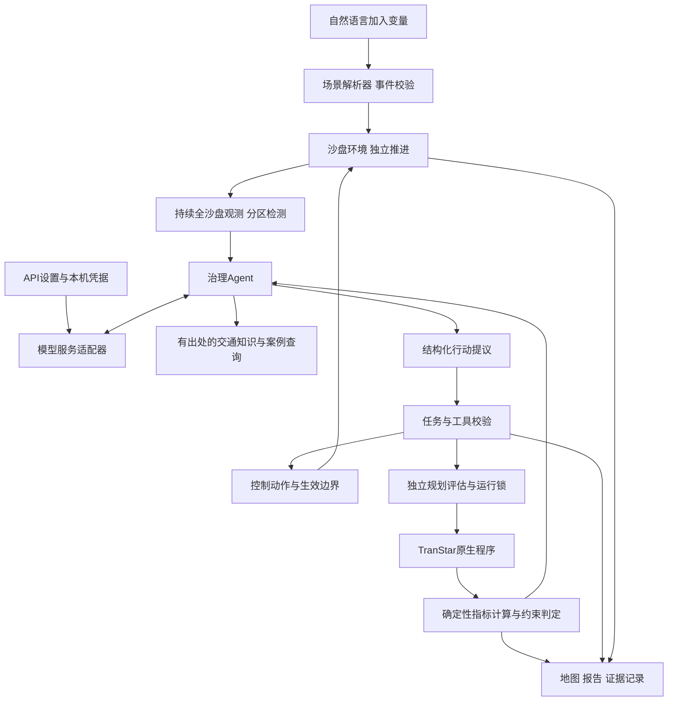

# 大模型交通 Agent 开发方案

> 2026-09-30源码测试交接：[仓库clone异机测试说明](20260930仓库clone异机测试说明.md)。固定功能源码`dc9a98fb`的1,088份已跟踪文件同机独立目录检查通过，204份LFS实体按提交哈希核对；停车与单向启动依赖通过，无新增模型请求或原生场景。远端LFS下载、物理异机、页面视觉及完整语义验收仍待完成；本轮是可交接的源码测试候选，不是整体通过。见[独立核验索引](validation/20260930_clone_source_handoff_review.json)。

> 2026-09-30最新：[总次数预算与停车格式修正](20260930总次数预算与停车格式修正.md)。总预算解析v2冻结明确总次数，旧协议保持；停车JSON语法失败有一次受剩余研究请求约束的重新提交，原校验保持、首次安全诊断及两次用量分别留痕。768项Python、4组Node通过。本次新基准＋单方向停车2级共2场景／14模块、3次请求／28,801tokens；核心改善15.8685%，邻区毛新增0.785km超0.1km门槛。第二次决策JSON解析失败，另一候选区未执行，整体needs_review／未完成，原任务未恢复。另1次／11,673tokens独立格式反馈探针返回合法同需求、同等级选择，未执行；仍有从两次超限推断普遍溢出的过度推论，语义needs_review。合计新增4次／40,474tokens，累计185次／1,840,412已知tokens。生产自动格式恢复、完整模型比较与推论质量、页面视觉、最新便携与物理异机待验证。见[独立核验及核账](validation/20260930_demand_design_full_and_arguments_offline_review.json)。以下保留各阶段当时记录。

> 2026-09-28最新：[源码真实闭环与语义复核](20260928源码真实闭环与语义复核.md)。固定 `a3009407` 完成两组6场景、42顶层模块、80次分车型调用；6次模型请求／67,906 tokens，自动转组与最终措施筛选已实测。原自动核验通过，但独立复核发现措施范围缩小、单向方向说明反转及控制响应与推荐资格混用，结论needs_review，整体未完成。源码8829；79份旧记录及七份锁保持，没有重试；本阶段未修改功能代码，语义缺陷、最终便携及物理异机仍待完成。累计64次／418,923 tokens，原12倍上限不变。以下为各阶段当时记录。

> 2026-09-28当前：[RC19量词冲突与有界修正](20260928RC19量词冲突与有界修正.md)。RC19真实初始量词冲突停止，1次请求／6,637 tokens／0场景；已实现保留原命题的字段修正，591项Python、四组Node、便携补充与浏览器离线通过。79份原记录和七份锁保持。最新源码8829待一次有上限真实联调，当前包RC19保持失败，最终交付与异机未完成。

> 2026-09-28当前：[RC18误拒绝与判定说明](20260928RC18误拒绝与判定说明.md)。一次真实尝试1次请求／6,696 tokens后被本地文本规则误拒绝，0个原生场景，原件封存。已实现v2整句说明区分、显式口径版本与旧v1回放；584项Python、四组Node和浏览器离线通过，78份记录及七份锁保持。用户随后授权累计上限为现有可核对总量12倍，先仅一个最多6次请求的混合案例；源码8826；RC19（`f441fcd7`）16,158文件及八项同机隔离检查通过，便携入口8828零付费预览通过；真实闭环和物理异机仍未完成。以下为各阶段当时记录。

> 2026-09-28最新：[RC17失败与字段修正接口](20260928RC17失败与字段修正接口.md)。一次真实验收用了2次请求／15,297 tokens，原问题被重述后校验失败，0个原生场景。现改为仅提交出错字段的专用工具，保留原问题与全部研究安排，实际字段选择和编译方案分别留痕；577项Python、四组Node和浏览器离线通过。77份运行记录及七份锁保持，原失败不改写，没有第三次请求。新版源码8823；RC18（`df946787`）16,158文件及八项同机隔离检查通过，便携入口8825零付费检查通过；修复后的完整真实闭环及物理异机均未完成，整体保持未完成。

> 2026-09-28最新：[RC16规划失败与判据对象修正](20260928RC16规划失败与判据对象修正.md)。RC16环境检查通过，单次真实尝试1次请求／6,592 tokens后因判据对象自相矛盾停止，未启动原生仿真。已实现预算内仅修正措施对象的一次机会，原问题及研究条件保持；573项Python、四组Node及浏览器离线通过。失败原件不改写，未追加付费重试。RC17按`6c58b300`构建并通过16,157文件与八项同机隔离检查，8822空白入口已核对；最新真实闭环及物理异机仍未完成。

> 2026-09-28最新：[问题口径与检验边界](20260928问题口径与检验边界.md)。初始假设与判据的明确冲突在原生执行前拒绝；原提问与实际检验口径分别留存。561项Python、四组Node及浏览器离线通过；本阶段零付费、零新原生场景。下一步固定候选并准备有限额真实联调；整体未完成。

> 2026-09-28最新：[选点依据与备选比较](20260928选点依据与备选比较.md)。新协议要求选点引用当前候选、备选及最新配对反馈，界面分开实测与待验证假设。547项Python、四组Node及浏览器离线通过；零付费、零新原生场景。语义质量、真实新协议闭环和最终交付仍待完成，整体未完成。

> 2026-09-28最新：[事前假设判据与配对复核](20260928事前假设判据与配对复核.md)。初始问题在执行前绑定可观测判据，最终不换条件；核心收益、推荐约束、邻区代价和相对单项收益分别判定。530项Python、三组Node及浏览器通过；本阶段零付费、零新增原生场景。真实新协议联调、语义对齐和最终交付仍待完成，整体未完成。

> 2026-09-28最新：[RC15真实闭环与禁行地图修复](20260928RC15真实闭环与禁行地图修复.md)。一个真实混合案例完成两组6场景、5次请求；自动核验通过，人工仍发现假设语义与解释问题，整体未完成。原件封存；源码修复单向地图漏标，并在六场景原件上只读核对，没有付费重试。

> 2026-09-28最新：[交接复核有界恢复](20260928交接复核有界恢复.md)。交接解释可在原预算内修正一次，与最终复核共享机会并预留全部剩余研究；501项Python及三组前端通过。本阶段零付费、零新原生场景，完整真实闭环与交付仍待验证，整体未完成。

> 2026-09-28最新：[跨组计划与实测数值核对](20260928跨组计划与实测数值核对.md)。RC12单次真实联调4次请求／3场景后因跨组计划误报停止，失败原件封存；已修复未来计划范围、实测耗时配对和完成状态。491项Python与三组前端检查通过，修复后没有付费重试，整体仍未完成。

> 2026-09-28接续实现：[分层复核与单项组合对照](20260928分层复核与单项组合对照.md)。多组假设在最终统一复核；新增同组实际措施、约束状态及组合差值，原始失败保持。477项Python及三组前端检查通过，本阶段零付费、零新仿真，整体仍未完成。

> 2026-09-28最新：[实测措施核对与RC10原生记录](20260928实测措施核对与RC10原生记录.md)。一次真实混合研究完成6场景、5次请求，但原核验器漏过模型停车等级和零代价错误，整体仍待核对。新参数事实协议及界面已实现，471项Python及三组前端检查通过；未追加付费验证或重写旧结果，整体目标未完成。

> 2026-09-28后续进度：[诊断范围与独立研究保留](20260928诊断范围与独立研究保留.md)修复观察顺序、道路诊断权限和明确独立研究的编排问题。461项Python及三组前端检查通过，新增付费／原生调用均为0；整体仍待真实闭环与交付验证。

> 2026-09-28最新实现与验证见[完整研究单元与RC9规划失败](20260928完整研究单元与RC9规划失败.md)及[事实入口](../项目事实基线与新对话入口.md)。RC9初始规划超预算失败，1次真实请求、4,931 tokens、0个原生场景；后续研究单元和预算修正仅离线通过，整体仍未完成。下文连续环境路线按用户后续决定保留为历史。

> **后续用户决策（2026-09-27）：已明确改为“根据情景自动匹配调度”。连续世界与 SUMO 路线暂停，本文保留为历史设计，不能作为当前必做验收。当前实现与验证见[智能规划便携候选验收](20260927智能规划便携候选验收.md)和[单向观测选点开发记录](20260927单向观测选点开发记录.md)，整体目标仍未完成。新服务为 Token Rhythm / Chat Completions / deepseek-v4-flash；密钥仅保存在本机加密配置。**

版本：2026-09-27，按用户澄清更新为环境驱动、持续观测与主动调整。本文是待开发方案，不是功能完成或测试通过记录。现有功能基线为规则智能体；本次重写方案不新增交通仿真，也不发起带密钥的模型请求。

用户已确定：开发一个实际可使用的大模型交通Agent；设置页必须能填写API；首个Base URL为 `https://agentrouter.org/v1`，接口类型为 `responses`，请求模型为 `deepseek-v4-flash`；测试使用用户本次提供的密钥。跨城市暂不推进，完整真实运行及异机验收后置到开发完成阶段。密钥不写入本文、源码、样例、报告或Git。

## 1 产品目标与完成定义

用户配置沙盘初始条件、治理目标与预算后，环境独立演化，Agent从开始到结束持续观察整个沙盘各区域，根据交通状态主动诊断、选择受控动作、检查反馈并继续调整。运行中的自然语言输入用于向沙盘加入变量，确定的因果链是**自然语言 → 环境变化 → Agent检测到变化 → 调整 → 环境反馈**。即使用户不再输入，车流演化、新拥堵和外溢仍应被发现。大模型实际参与“观测—选动作—调用工具—读取反馈—再决策”循环。

持续监测与主动调整是必做能力，详见[持续监测与主动调整设计](20260927持续监测与主动调整设计.md)。场景语言解析器只修改环境事件，治理Agent依据环境观测行动，两者分开权限和上下文。当前TranStar适配器按完整场景计算，尚未实现连续交通状态推进；必须先明确环境后端路线，不能仅用监听文件、整轮静态重算或地图刷新代替完整目标。用户已明确是在讲路面情况及持续调控，不是专门的车辆清空任务。

以下六项全部具备后，才描述为“大模型交通Agent已完成”：

1. 从设置页配置服务、模型和密钥，完成真实模型连接与工具调用回合。
2. 理解启动配置及中文环境事件，生成合法任务卡／事件；事件经校验在环境生效，语言文本不能直接成为治理动作。需要确定道路、事件参数或预算等关键条件时能提出具体澄清。
3. 在受控工具集合中真正选择行动；至少有完整记录证明模型读取一次实际仿真反馈后提出下一步，并由执行层接受或拒绝。
4. 地图、状态、聊天和报告绑定同一任务的实际数据；每项数值结论能追到计算结果。
5. 在最终代码上完成本机真实闭环、核验和交付。异机一项以实际取得的另一台机器记录单列，不用同机解压代替。
6. 持续模式中环境与观测独立运行，全沙盘各区域从开始到结束均受监测；验证无新聊天消息也能按状态变化自主调整，并验证环境事件先实际生效、再被观测和响应。覆盖跨区变化、过期动作、暂停、恢复及预算结束。仅完成静态批次重算不满足此项。

大模型是本项目新增的必做要求。赛题原文仍允许规则路线；接入大模型本身不能直接证明加分，展示与实验应证明它提升了任务理解、工具编排或反馈决策能力。此前“暂不优先大模型”和“先做报告整理”的工作排序由本方案更新。

## 2 用户如何使用

1. 点击大厅顶部的“设置”，选择AgentRouter或自定义兼容服务，填写服务地址、模型、API Key，保存。
2. 点击“测试连接”，页面分别报告连通、鉴权、模型返回和工具调用兼容性。此操作不调用TranStar，不把它算作交通实验。
3. 在左侧设置初始路网与需求、目标、监测范围、允许措施、时限与预算，然后开始沙盘。环境推进和监测随之启动，治理Agent根据观测自主工作。
4. 运行中在“向沙盘加入变量”输入框填写事件，例如“5分钟后让A区入口车流增加20%，持续10分钟”。场景解析器校验地点、单位、时间和后端支持情况，再登记环境事件；Agent从其后的实际观测获知变化。事件不合法时只报告该事件失败，已运行的监测继续。
5. 右侧分列环境事件和Agent观察／行动，显示证据、进度、失败原因和预算；中间地图显示当前世界、仿真时钟、观测年龄与分区覆盖。未知指标保持未知，单独查询历史任务时才切到相应完成场景。
6. 任务结束后查看建议、被拒候选、局部代价、模型及工具记录，并导出报告。

持续模式区分“暂停世界”和“暂停自动调控”，后者仍保留环境推进与监测。用户一次确定目标、允许动作、触发规则与总预算；后台在这个范围内自主推进。无新消息时继续演化与采样，无需调整时可保持策略而避免重复模型调用。模拟事件必须标注为用户设定或合成输入；没有连续环境执行器时，完整持续模式标为待实现，不能展示虚构动态车流。

旧的单次研究入口仍可比较有界停车治理方案，并查看历史证据；其批次研究身份与持续沙盘明确区分。大模型解释结果使用只读入口，不能绕过环境输入和控制动作边界。

解释历史结果属于只读会话；“开始新仿真”属于新任务。切换数据源或修改已冻结硬约束时生成新任务版本，不在原实验中悄悄改变对比条件。

## 3 API 设置入口

沿用现有科技感大厅和大地图布局，在顶部增加设置按钮；API设置放入独立面板，避免把连接参数混进交通指标区。

| 项目 | 设计 |
| --- | --- |
| 服务配置 | 首个预设为AgentRouter；提供Responses接口，Chat Completions作为显式可选适配 |
| 服务地址 | 用户确认的Base URL为 `https://agentrouter.org/v1`，允许编辑；Responses请求路径为 `/v1/responses`，不得重复拼接 `/v1` |
| 接口类型 | 默认 `responses`，按用户提供的服务文档示例；切换接口需明确配置，不因一次失败自动换协议并隐去错误 |
| 模型名称 | 默认填写用户指定的 `deepseek-v4-flash`；不得擅自替换成其他供应商或模型 |
| API Key | 密码输入框，支持保存、更换、清除；读取设置仅返回“已配置”标志，保存后不回传完整密钥 |
| 连接测试 | 使用当前后端配置，展示阶段结果、耗时、请求模型和服务返回的模型名；错误信息脱敏 |
| 高级选项 | 请求超时、模型调用次数和Token预算；思考模式仅在确认服务支持后提供，不盲目发送供应商专有参数 |
| 当前模式 | 明确显示“大模型Agent”“规则模式”或“API未配置／不可用”；不得无声切换后继续宣传为大模型决策 |

密钥由本机后端保存到项目目录之外的用户配置区，Windows采用当前用户DPAPI保护。非密钥配置与密钥引用分开；密钥不进入浏览器localStorage、实验快照或便携包。其他机器首次使用需在自己的设置页填写密钥，不能把本机保护的密文当作可迁移授权。

设置接口保持现有本地同源限制。建议新增 `GET /api/settings/llm`、`PUT /api/settings/llm`、`POST /api/settings/llm/test`；更新密钥使用明确的保留／替换／清除动作。新路由在现有任务卡解析之前分发，避免把设置请求当成交通任务。后端向指定服务发送请求，不把鉴权头跟随跨域重定向转发。

不含密钥的首个配置示例：

```json
{
  "provider": "AgentRouter",
  "base_url": "https://agentrouter.org/v1",
  "wire_api": "responses",
  "model": "deepseek-v4-flash"
}
```

用户提供的示例还列有其他模型和 `CODEX_GATEWAY_API_KEY` 环境变量名，它们用于说明兼容接口；本项目仍使用指定的DeepSeek模型，设置页独立保存凭据，不要求修改用户的Codex全局配置。

本轮只读查询了AgentRouter公开首页、公开状态和未鉴权模型路径；未用用户密钥，不能据此声明模型或工具调用已通过。AgentRouter与其他同名网关项目不可混用文档或服务地址。

## 4 Agent 架构与现有代码复用



| 模块 | 新增或改造内容 | 复用边界 |
| --- | --- | --- |
| `llm_settings.py`（拟新增） | 配置校验、凭据读写、脱敏状态 | 不把密钥传入知识工具或任务卡 |
| `llm_client.py`（拟新增） | Responses优先的兼容HTTP接口、超时、响应校验、用量记录 | 首版优先非流式完成请求，页面仍持续显示本地工具进度；Chat Completions另用适配器转换，不混淆两种结构 |
| `llm_tools.py`（拟新增） | 工具定义、参数校验、动作与观测引用 | 只调用已有受控数据与仿真能力 |
| `llm_agent.py`（拟新增） | 会话、工具循环、停机条件、预算及状态恢复 | 不把调用完整旧规则流程后写一段总结当作新Agent闭环 |
| `scenario_events.py`、`environment.py`（拟新增） | 语言转环境事件、独立世界时钟与状态推进、环境后端能力适配 | 场景编辑器无治理工具权限；连续环境尚无已接入后端，先做M0；不把原始文本直接交治理Agent执行 |
| `monitor.py`、`control_session.py`（拟新增） | 全沙盘与分区监测、数据新鲜性、触发、策略版本、暂停恢复 | 环境、监测与模型请求独立调度；覆盖不同区域，不受聊天与地图视口限制；细节见补充设计 |
| `agent.py`与执行公共层 | 提取独立场景执行、指标与证据公共接口 | 现有 `Agent.run` 混合了初始化和规则搜索，需要小范围拆分；旧规则行为与已封存协议保持兼容 |
| `task.py`、`data.py`、`selection.py` | 任务合法性、真实指标、硬约束和最终筛选 | 模型不能改计算结果、掩盖违例或绕过预算 |
| `knowledge.json`及检索层 | 按主题和字段返回手册依据及适用范围 | 首版采用有出处的本地检索，必要时增加检索能力，不宣称已有完整向量知识库 |
| `web.py`和前端 | 设置、对话、动作时间线、状态与地图联动 | 原规则任务、历史档案与地图入口继续可读 |
| `verify_llm_session.py`（拟新增） | 核对模型调用、工具时序、预算及原生证据 | 不要求再次调用大模型得到逐字相同回答；不修改旧规则审计来给新任务放行 |

将“哪个控制器决定下一动作”与“如何执行、计算和核验”分开。单次研究的控制器版本拟为 `llm-parking-v1`，持续模式另记为 `llm-traffic-watch-v1`并记录环境后端及允许措施版本；规则版仍是可运行对照。LLM新任务、旧规则任务和历史复评分别记录类型，不混写原报告的Agent身份。

首个TranStar大模型批次闭环先支持已验证的停车治理动作。持续沙盘的环境事件与控制动作须按选定后端另外验收，不能继承静态停车结果作为动态控制证据。模型可以解释显式单向和禁转的现有证据，但自动调用这些执行分支应单独开放和验收；施工、公交优先、信号、错峰仍保留能力门槛。

Responses适配器从 `output` 中读取 `message` 与 `function_call`，按 `call_id` 回传 `function_call_output`，输出预算使用 `max_output_tokens`。不能按Chat Completions的 `choices[0].message` 结构解析。客户端保存有界会话历史，不依赖网关持久化或 `previous_response_id`；DeepSeek原厂文档说明其Responses接口无状态，网关实际支持范围最后单独验证。[Responses接口文档](https://api-docs.deepseek.com/api/create-response/)。

模型一次返回多项工具请求时，由本机调度器校验并串行处理有状态动作，TranStar始终受原生锁约束。工具步数、预算和重试限制由本机执行，不能仅依靠接口中的并行或工具次数参数；原厂指南注明其中部分参数可能被忽略。[Responses使用指南](https://api-docs.deepseek.com/guides/responses_api/)。

## 5 工具与行动边界

| 工具 | 返回或产生什么 | 执行条件 |
| --- | --- | --- |
| `inspect_dataset` | 数据来源、路网规模、可用能力与输入检查摘要 | 注册的数据源标识；不接收任意文件路径 |
| `lookup_knowledge` | 手册条目、参数意义、出处和限制 | 主题白名单、结果长度上限 |
| `draft_task` | 结构化任务卡与尚缺条件 | 经 `Task` 校验；未获准的场景不自动替换为停车 |
| `read_observation` | 指定已完成场景的指标、违例、候选摘要 | 只读当前授权任务已产生的数据 |
| `diagnose_baseline` | 实际新基准的瓶颈与候选、固定评价范围 | 没有新基准时不能假造诊断；无候选允许结束 |
| `propose_parking_policy` | 候选措施及简短依据，引用观测与知识ID | 限已冻结候选路段、允许的停车类别和任务预算 |
| `simulate_policy` | 新场景的执行标识、状态和后续结果引用 | 输入白名单、运行锁、去重、预算及配对预留均通过 |
| `compare_policies` | 由程序计算的同需求比较与跨需求资格 | 缺测保持缺测；不可用平均改善抵消硬约束失败 |
| `read_monitor_state`、`inspect_region` | 全沙盘摘要、指定区域真实观测、环境与策略版本、触发事件、数据年龄 | 监测由后端持续运行，不能依赖模型主动调用才采样；不暴露未来隐藏事件或场景编辑原始提示词 |
| `activate_policy` | 在环境后端允许的控制边界施加已校验策略 | 环境代次、策略版本、有效期和最新状态前提通过检查，动作适配已验证；不控制现实道路 |
| `hold_policy` | 保持策略并等待下一触发，记录原因与期限 | 不关闭后台异常与新鲜性监测，不默认无限运行 |
| `finish_task` | 最终建议、未测项和报告草稿 | 只有独立核验过的数值可进入结论；合格性与最终筛选由冻结规则约束 |

大模型可以提出下一条路、治理强度、需要补测的需求点或停止搜索；不能任意执行Shell、改原始数据库、扩大冻结的实验范围、放宽安全阈值或直接写入成功状态。模型可自由解释候选权衡，但“哪项有资格被推荐”和数值本身必须由程序重算。

持续会话启动时冻结授权区域、动作类型、阈值和总预算；监测覆盖整个已加载沙盘，区域可动态成为治理对象，不能只观察首次候选。授权范围外的问题仍报告，不自行扩权。动作绑定环境代次、策略版本、有效时间窗和状态前提，生效前用最新观测复核；不能简单要求观测序号完全不变，导致环境每步推进都拒绝所有动作。TranStar规划子任务另冻结各自输入、候选和对比条件。

每次动作保存 `session_id`、`tool_call_id`、动作参数、引用的观测、简明依据、校验结果和执行结果ID。动作先于对应原生调用记录。工具失败与模型参数错误也进入日志，避免只保存成功路线。

## 6 会话 数据与证据

会话使用独立目录保存结构化任务、模型配置快照（不含密钥）、消息摘要、工具事件及关联的原生JOB。模型侧只接收必要的任务、知识片段和指标摘要，不把整个三万行路网、重复日志、绝对本机路径或凭据堆入提示词。

会话状态拟为：`draft` → `ready` → `running` → `completed`，并有 `needs_input`、`no_candidate`、`failed`、`cancelled`。长仿真以后台任务运行，页面断开不等于取消计算；重新打开后按真实JOB状态接续查看。网络请求超时后先查询该工具动作是否已执行，不重复创建同一场景。

持续会话还包含 `watching`、`replanning`、`applying`、`paused`、`stale`、`budget_exhausted`，独立记录世界运行与自动调控的开关。子任务完成不等于监测会话结束；原生评估的基准和治理必须使用同一输入版本，动态动作按有效期与最新前提复核。当前原生场景保留到安全边界，禁止中途改写输入。事件先在环境生效、再形成观测、再触发动作的时序，以及无消息时的监测覆盖，均进入新核验器。详细时序、状态恢复和停止规则见补充设计。

模型请求数、工具步数、Token和原生调用预算分别计费，启动前冻结。API短暂错误可有限重试；原生重试沿用明确登记条件，不能因治理效果不好而重跑。配对需求和基准复跑留出预算，剩余不足就停止新候选。

记录请求模型、返回模型名、服务地址、可取得的请求ID、用量与响应时间；网关没有返回的字段写未知。请求名 `deepseek-v4-flash` 不构成对上游真实权重版本的独立证明。费用只有存在可靠价格与完整用量时才显示金额，否则只显示用量。

用户界面呈现简明行动理由和证据引用，不展示或依赖隐藏思维链来证明正确性。协议要求的续接字段由适配器保留并正确回传，放在会话私有缓存，不混入公开评审资料。可复现证据是“保存的动作能按相同输入与工具结果核验”，不是宣称线上大模型每次生成完全一致。

新核验器复用原始输入、输出新鲜性、指标计算、范围与预算检查；另外验证模型动作仅引用已产生观测、工具调用与执行一一对应、未越权、未超额。旧核验器中的固定规则决策重放不能直接冒充LLM决策验证，旧档案仍用匹配版本核验。

## 7 页面和报告怎样证明 Agent 在工作

- 大厅顶部显示模型状态和设置入口；右侧设“对话”“执行过程”“结果”三个视图，中间保持真实大地图。
- 每个模型动作显示“依据哪份观测、调用哪个工具、参数为何、程序是否接受”；等待API、原生计算、分析结果三种状态分开。
- 显示剩余模型与仿真预算、已测需求点、候选通过或拒绝原因；地图只展示已有真实结果。
- 持续模式分别展示环境事件和Agent行动，显示仿真时间、各区覆盖、最近观测时间、触发原因、当前／待生效策略、暂停世界／暂停调控和停止入口。页面刷新、状态采样与模型决策频率分别记录；尚无连续环境时不得用动画填补。
- 最终报告分列大模型提出的动作、校验器拒绝的动作、真正执行的仿真和确定性推荐，保留失败和无收益结论。
- 页面和导出按任务类型声明规则／大模型控制器，来源标注与既有南京／教学数据区分继续保留。
- 模型文本按安全文本或受控Markdown渲染；不能把模型返回HTML作为可信页面脚本执行。

## 8 开发阶段与后置验收

用户要求完整运行放在后面最后测试；因此先完成模块、界面与必要的局部验证，再集中执行真实API与TranStar联调。开发中的单元检查不冒充真实运行。

| 阶段 | 交付 | 完成标准 |
| --- | --- | --- |
| M0 环境能力与接口设计 | 核查TranStar状态推进和控制边界；确定可执行的环境后端路线、事件与观测契约 | 明确原生能做什么、是否需要独立动态环境；只读调查和开发检查不冒充最后真实验证。仅支持批次时不能把持续沙盘标完成 |
| M1 设置与服务适配 | API设置面板、凭据存储、兼容客户端、脱敏错误 | 可填写、更换、清除配置；用受控假响应验证边界，不在这一阶段启动交通仿真 |
| M2 环境 监测与治理循环 | 独立环境推进、语言转环境事件、全沙盘采样、Agent工具、预算与持久化 | 开发检查证明语言不直达治理工具、无消息仍采样、跨区检测与旧动作拒绝；环境后端实现后仍标真实联调待测 |
| M3 可使用的Agent大厅 | 沙盘变量输入、事件状态、全图监测、Agent行动、暂停世界／调控和报告 | 界面可完整操作并区分环境变化与治理响应；显示观测时间、覆盖和生效边界 |
| M4 最后真实验收 | 用户模型工具往返、有界持续沙盘与匹配的真实TranStar规划评估 | 证明无消息持续监测、环境先变化再触发、跨区自主调整；各后端状态与动作证据、原生配对及复跑单独核验；如失败照实记录 |
| M5 发布与评审材料 | 新便携版、报告、手册、演示、异机验收步骤 | 同一源码版本的五类材料可移交；密钥不入包；取得异机实跑记录后才写异机通过 |

最终验收顺序：

1. **API冒烟**：使用用户指定服务、模型和密钥，以少量请求核对鉴权、输出结构、一次实际工具调用及工具结果回传。只显示脱敏诊断；不将简单聊天成功当作Agent成功。
2. **历史观测回放**：读取已保存的成功／约束失败观测，让模型选择下一工具，检查参数合法性与引用。这是开发验证，不增加交通仿真证据，也不称独立盲测。
3. **本机真实闭环**：按补充设计预登记有界沙盘的初始状态、事件时序、多个观测区域、模型配置、允许动作、总预算和判据，证明没有用户消息也持续观测和调整；中途语言只创建环境变量，再检查观测驱动的响应。原生规划评估使用匹配的南京案例输入快照，另保留同条件基准、三需求点和复跑，三需求点不当作连续时间轴。采用独立动态后端时必须分别标注来源并完成状态／动作核验；只有批次求解则持续目标未完成。会话只启动一次，保留所有提议、拒绝和结果；预算不足时事前缩小范围，不在运行中删去失败或必要验证。
4. **规则对照**：若要声称大模型比原规则更好，另行冻结同候选、同预算、同约束对照。评价任务理解、合法工具比例、合格方案、调用次数、耗时和局部代价；不只比较回答文字。没有对照优势也可以完成可用Agent交付，但结论如实。
5. **发布及异机**：冻结发布源码后制作新包，用包内入口验收；另一台Windows真实新任务属于最后阶段，当前没有可用第二台机器时先完成其余交付和可移交步骤。

至少覆盖：无API配置、无效密钥、模型不可用、服务超时／限流、无效JSON、未知工具、凭空路段、修改硬约束、重复执行、预算耗尽、仿真失败、无候选、未测方案被推荐、API错误中夹带敏感信息，以及环境事件被拒／未生效、未来事件泄露、跨区漏观测、无消息运行、变化后的旧动作失效、模型跟不上环境、策略振荡、暂停世界／调控与重启恢复。开发验证关注这些实际失败路径，不以测试数量作为提分指标。

## 9 接口资料与当前未知项

用户指定网关为[AgentRouter](https://agentrouter.org)，并补充Base URL `https://agentrouter.org/v1` 与 `wire_api = "responses"` 示例；首版按Responses工具调用实现，没有授权改用其他服务。DeepSeek原厂能力不自动等于中转网关已支持，M4必须验证真实工具往返。[Responses接口文档](https://api-docs.deepseek.com/api/create-response/)、[使用指南](https://api-docs.deepseek.com/guides/responses_api/)。

如果使用思考模式，适配器须按实际接口要求处理续接字段，不能在多轮工具请求中随意丢弃；不支持的字段明确报告或在已验证的配置中关闭，不能猜测兼容性。[思考模式文档](https://api-docs.deepseek.com/guides/thinking_mode/)。JSON模式仍须校验空响应、截断和业务字段，不能把有效JSON等同于正确交通决策。[JSON输出文档](https://api-docs.deepseek.com/guides/json_mode/)。

当前尚未确认用户密钥的可用状态、网关对该模型的具体工具／思考模式兼容性、实际Token用量及费用；这些留到最终真实接入测试。本文未保存密钥，后续开发或新机器在设置页配置，不能把密钥复制到开发交接或GitHub。

## 10 新对话开发提示词

```text
在 F:\ITS比赛 开发可实际使用的大模型交通Agent。
先读 项目事实基线与新对话入口.md 和 docs/20260927大模型交通Agent开发方案.md。
再读 docs/20260927持续监测与主动调整设计.md。用户已明确：自然语言→环境变化→Agent检测→调整；运行中语言仅注入沙盘变量，不能直达治理动作。环境独立演化，监测从头到尾覆盖全沙盘不同区域，无新消息也应自主发现问题与调整。当前只有整轮TranStar求解，须先明确连续环境后端，不能用监听文件、地图刷新或独立静态场景拼接替代完整目标。
本轮主线已由用户确定：大模型Agent必做，设置页必须可填写API；跨城市暂不推进，完整运行和异机验收放到开发完成后的最后阶段。旧文档“暂不优先大模型”的排序已被更新。
首个Base URL为 https://agentrouter.org/v1，wire_api=responses，请求模型 deepseek-v4-flash。按Responses的output、function_call和function_call_output实现工具往返，客户端管理会话，不依赖服务端保存历史。密钥只从用户设置或本机受保护配置取得，禁止写入源码、日志、报告、便携包和Git。
按M0明确环境适配路线，按M1—M3实现API设置、场景事件解析、独立环境推进、全沙盘监测、治理工具循环、预算、时效校验、真实执行接口和大厅。场景解析器与治理Agent隔离上下文及工具；后者从环境观测行动，不能读取未来隐藏事件。模型请求不阻塞环境采样，区分暂停世界与暂停自动调控。大模型须能读取工具结果再选择下一步，不以包装旧规则run并润色总结冒充闭环。
复用既有TranStar执行、指标及约束核验；保留规则控制器作对照；新控制器和审计版本单列，保护历史任务与失败证据。
开发完成后按M4集中做真实API工具往返、有界沙盘的无消息运行／环境注入／跨区响应及真实TranStar规划评估，测试使用用户配置的指定密钥。若引入独立动态后端，输出和证据明确区分，禁止冒称TranStar连续仿真；只有批次计算时完整持续目标仍未完成。结果通过才标已验收，失败或无收益如实报告。最终再做新包、同版本材料和异机验收。
先检查实际Git状态与原生进程。完成一个明确阶段就更新事实入口，标明已实现、已真实验证和仍待验证的部分，不把规划写成现有能力。
```
