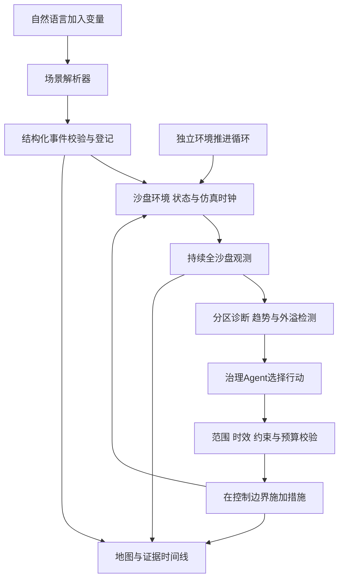

# 交通 Agent 持续监测与主动调整设计

> **后续用户决策（2026-09-27）：已明确改为“根据情景自动匹配调度”。连续世界与 SUMO 路线暂停，本文保留为历史设计，不能作为当前必做验收。当前实现与验证见[研究完成门槛与完整对照验收](20260927研究完成门槛与完整对照验收.md)。新服务为 Token Rhythm / Chat Completions / deepseek-v4-flash；密钥仅保存在本机加密配置。**

版本：2026-09-27，按用户澄清重写。本文补充[大模型Agent开发方案](20260927大模型交通Agent开发方案.md)，是待开发与待验收设计。本轮只核查代码、手册和候选接口资料，未调用模型API、未运行新交通仿真。

## 1 已明确的产品逻辑

用户明确：**自然语言 → 环境变化 → Agent检测到变化 → 调整**。语言输入用于往沙盘中加入变量；Agent从开始到结束持续观察整个沙盘的不同区域。没有新的聊天消息时，环境仍按已有需求和交通规律演化，Agent仍能发现拥堵、外溢或恢复并采取行动。本需求是持续交通场景控制，用户没有提出“疏散直到道路清空”的专门任务。

因此产品应有三个独立运行部分：

| 部分 | 责任 | 唤醒来源 |
| --- | --- | --- |
| 沙盘环境 | 保存路网、交通状态与仿真时钟，推进交通，接收外部事件和控制动作 | 仿真调度器；不依赖聊天消息 |
| 持续观测器 | 按约定周期覆盖全沙盘，跟踪各区域状态、趋势和外溢，产生异常或重评事件 | 已完成的仿真步／有效观测；不依赖LLM主动查询 |
| 治理Agent | 读取观测、诊断、选择受控动作、检查后续效果，再继续关注新问题 | 观测触发、定期重评或动作反馈；不直接由用户描述的“有问题”作出治理动作 |

场景编辑可以使用大模型理解语言，但与治理Agent分开上下文和工具权限。设置目标、预算和允许措施属于启动配置；运行中的“环境输入”默认只创建沙盘事件。解释结果另走只读入口。

## 2 从语言到环境，再到行动

例如，用户输入“5分钟后让A区入口车流增加20%，持续10分钟”。场景解析器只生成带地点、仿真时间、幅度、单位和持续期的事件，环境在相应时刻施加需求变化。监测器随后读取实际车流、速度和可取得的队列等状态；达到触发条件后，Agent自主决定是否治理，以及优先处理哪个区域。A区调整后若B区出现外溢，B区持续观测会触发后续调整，用户不必再报告“B区也堵了”。例中的地点和幅度是任务输入，不代表已测结果。

必须保留这些边界：

- 事件有 `scheduled`、`applied`、`rejected`、`expired` 状态和实际生效时刻。写入队列不等于已经改变环境；失效、地点不明或执行器不支持的事件应显示原因。
- 需求、容量、封闭等事件只能修改执行器支持的环境变量，不能直接写出“速度下降”“拥堵已改善”作为观测。指标由执行器产生或从原始状态确定性计算。
- 治理Agent不接收场景编辑器的原始用户提示词、预定正确答案或未来隐藏事件。它可读取观测权限内已经发生的环境信息；带有“请直接改某策略”的文本不能穿过环境入口变成治理工具调用。
- 事件解析需要的澄清只影响该事件，已运行的沙盘和持续监测继续工作。无法解析的输入不触发凭空治理。
- 控制动作与用户注入事件分开登记，记录来源和适用时段；Agent不能删除不利事件、降低待服务需求或改目标来伪造治理收益。

## 3 持续监测的覆盖与节奏

监测对象是整个已加载沙盘及其各分区，不局限于第一次选中的候选道路，也不随用户地图视口缩小。固定监测清单记录所有路段／区域及缺测原因；热点优先分析时，仍要保证其他区域在规定最大间隔内被检查。

每份观测至少包含来源、环境代次、观测序号、仿真时间、墙钟采集时间、完整性、各区状态及数据年龄。按执行器实际能力选择速度、流量、密度／占用、队列、延误、服务需求和下游外溢指标；没有可靠输出的指标明确缺失。记录监测覆盖率和最长未观测间隔，不能仅报告处理了几个热点。

监测与LLM调用采用不同节奏：

1. 环境按已声明的时间步推进，观测器按确定的采样周期采集；环境和监测调度不阻塞在远程模型请求上。
2. 确定性检测器分析阈值、连续趋势、突变、措施反馈及跨区外溢。定期重评用来发现缓慢恶化；数据没变化时仍采集和检查，但不反复进行无依据的模型调用。
3. 治理Agent接收全局概况和按优先级组织的局部证据，并可查询某区域更详细的观测。大路网不整表塞进每次提示词；局部查询不停止全局监测。
4. 触发／解除阈值、最短策略保持期、冷却期和最大切换次数预先配置，抑制来回调控。多个区域竞争资源时记录优先级和暂未处理原因；不能永久忽略非热点。
5. 模型慢或失败时，监测继续工作，保留待处理事件并显示延迟。最新摘要可合并，原始环境事件和观测证据保留，停止与硬约束事件不得丢失。

分别记录仿真步长、采样间隔、模型决策耗时和控制生效延迟，不提前承诺1秒或5秒内完成。沙盘倍速过高导致模型跟不上时显示积压和过期动作；改变倍速或暂停世界时明确记录，不能偷偷停住环境等待模型再声称实时调控。

## 4 动作校验与变化中的状态

启动时冻结可操作区域、措施集合、阈值和预算。监测可以覆盖全沙盘；动作边界由任务授权配置决定。Agent可依据新观测在授权区域内动态选择治理对象，不能永远限于首次候选，也不能自行扩大权限。每次候选集合、评价范围和选择理由单独版本化，历史静态实验仍保持原协议。

LLM提出动作后，由执行层检查结构、地点、措施能力、约束、互斥、预算、时效及当前适用条件，再在执行器允许的边界施加。必要的候选推演在独立分支运行，不先向主沙盘试施加、再把失败当作没发生。历史合格策略不能自动视为新状态下仍合格。

持续演化下，不能要求“动作依据的观测序号必须等于最新序号”，否则每次推进都会使动作失效。动作应绑定环境代次、当前策略版本、有效仿真时间窗及可检查的状态前提；提交时用最新观测复核。环境重置、重大事件导致前提失效、策略冲突或超过有效期时拒绝并重评。静态TranStar子任务另采用严格输入摘要匹配。

记录“建议”“验证中”“已施加”“效果待观测”“已观察到效果”。施加成功不代表收益成立；后续观测还需检查原区域、邻区和全网。硬约束由程序拦截，不能等LLM决定是否遵守；回退也须符合当时环境条件。

首版已验证的停车类别是管理情景参数，不能解释成路边车辆瞬间移走。施工、封闭、信号和需求事件，以及停车治理的实施时滞，都按环境后端与措施适配器逐项声明支持程度，不因语言能解析就宣称能执行。

## 5 当前能力差距与环境后端

本轮核查事实：

1. [runner.py](../traffic_agent/runner.py) 的 `validate_source` 只接受已验证的五次多路径增量加载；`execute` 逐个启动原生程序、等待结束，再核验完整输出与输入未被改写。当前适配器未实现交通时间步、车辆状态续跑或求解中在线修改控制接口。
2. [agent.py](../traffic_agent/agent.py) 为每个方案建立独立场景，不能据此认定车辆或排队状态沿物理时间连续传递。
3. [app.js](../traffic_agent/static/app.js) 约每3秒请求任务状态，属于页面刷新；[web.py](../traffic_agent/web.py) 没有持续沙盘状态采集入口。
4. 手册描述了数据导入的“循环运行／无限循环”，见[手册摘录](../工作材料/文本摘录/城市交通版说明书.txt)第1292—1295、6937—6940行附近；第7111行附近介绍分配方法。上述描述尚不能证明已接入持续演化与在线控制能力。

**仅增加后台定时器、监听输入文件或串接独立静态场景，不满足用户此次要求。**这些可作为开发阶段的调度验证或低频规划功能，不能标为“持续交通沙盘已完成”。

环境适配器拟声明 `advance`、`observe`、`apply_event`、`apply_control`、`checkpoint` 等能力及时间语义。先调查可用TranStar原生接口，确认是否能连续传递交通状态、在控制边界修改参数并导出观测。若能支持，原生适配与证据优先；当前不能把未找到接口扩大成断言整个软件不支持。

若可用TranStar接口仍限于批次交通分配，需补充独立的动态环境后端才能实现完整目标。可评估SUMO／TraCI：官方Python接口提供仿真步进、每步订阅和区域上下文订阅，以及控制接口；这只证明候选后端具备相关接口，不证明本项目已接入或南京数据可直接使用。[官方接口与订阅文档](https://sumo.dlr.de/docs/TraCI/Interfacing_TraCI_from_Python.html)。状态存档与恢复需按后端支持范围验证。[官方状态存取文档](https://sumo.dlr.de/docs/Simulation/SaveAndLoad.html)。

双后端路线需新增路网／需求映射、参数与车辆单位校验、环境事件和治理动作适配、明确的输出来源和独立对照。TranStar用于其已验证的交通分配与规划评估，动态引擎提供连续场面；动态输出不能署名为TranStar结果，也不能把两个引擎的不同口径当作同一次仿真收益。短周期控制不应等待每次分钟级TranStar求解，原生评估可在匹配输入快照上异步进行，但陈旧结果不得直接用于当前控制。

采用哪条环境路线在开发初期形成明确能力结论并写回主方案；补充后端尚未接入前，完整持续模式仍标待实现。本轮没有安装外部引擎、变更现有原生执行代码或编写替代车流模型。

## 6 模块、状态与界面

| 拟新增模块 | 职责 |
| --- | --- |
| `scenario_events.py` | 语言转结构化环境事件、地点解析、单位／时间校验、事件状态；无治理工具权限 |
| `environment.py`及后端适配 | 世界状态、时钟、推进、事件与动作生效、能力声明；独立于浏览器和聊天 |
| `monitor.py` | 全沙盘订阅／采样、分区诊断、覆盖、新鲜性、触发与事件聚合 |
| `control_session.py` | 环境与策略代次、待执行动作、预算、生命周期和恢复 |
| `llm_agent.py`及工具层 | 从观测出发的治理循环、合法动作提议、效果复查；复用主方案的API设置和客户端 |

事件入口拟为 `POST /api/sandbox/{id}/events`，治理观测与动作走后台内部队列。环境入口不直接调用治理工具；事件解析与治理即使使用同一模型，也分开提示词、可用工具及审计身份。页面对会话提供创建、状态、暂停、继续和停止操作，沿用本地同源限制。

暂停分为“暂停世界”和“暂停自动调控”：前者在支持的安全边界停止仿真时钟，后者世界与监测继续、只禁止新自动动作。界面明确选择和状态。停止结束整个会话；在运行中的原生场景仍需安全清理并保留失败／中止证据，不能使用部分输出。

关闭页面不影响后台已启动循环；主机睡眠、服务退出或断电会中断处理。恢复时核对实际进程、运行锁、环境存档、动作登记及数据年龄；不能仅凭旧 `running` 字段重启第二次求解，也不能在不支持恢复时伪造连续时间。无存档时创建明确的新环境代次。

界面保留大厅布局：左侧配置环境、自动调控目标与预算；中间显示当前世界及分区监测；右侧分别呈现“环境事件”和“Agent观察与行动”。语言框标注“向沙盘加入变量”，例如车流变化或后端支持的事件。地图显示仿真时钟、观测年龄、监测覆盖和数据来源；选中某地不会停止其他区域的观察。

## 7 因果证据与有效性

一次自主调整的证据链为：环境事件登记／自然演化 → 环境状态变化 → 原始观测 → 检测触发 → 模型动作 → 执行校验 → 实际施加 → 后续状态。记录各环节ID、环境代次、策略版本、仿真时间与墙钟时间。没有用户事件的变化也有独立观测与触发记录。

动态环境须检查交通状态连续和需求守恒，区别车辆数与PCU；跟踪未能入网的需求、未到达车辆及执行器的删除／传送等异常。不能把丢弃车辆、减少事件需求或忽略未服务量当作改善。数据驱动仿真、人工设定事件和现场实测各自标注。

比较控制策略时，使用相同初始状态、外部需求与事件、可见信息时序、允许动作和预算；未来事件不提前泄露给治理Agent。动态反事实推演需验证存档／分支能力，固定随机设置并记录局限。静态TranStar评估仍按同输入基准与治理配对核验；跨时刻速度自然变化不能全部归因于Agent。

报告交通指标外，还报告全沙盘监测覆盖、漏检／误触发、检测与控制延迟、无用户消息期间的自主动作、无效／过期动作、切换次数、调用量及未处理问题。持续采样不代表每步必须调用LLM或修改策略，保持现状也要有适用依据。

## 8 开发与最终验收

新增M0环境能力设计，M1保持API设置与模型接入，M2实现独立环境循环、场景事件、监测与治理循环，M3贯通大厅。按用户安排，开发中的受控观测检查与最终真实模型／仿真联调分别记录；受控事件桩不作为真实交通演化证据。

最终验收至少覆盖：

1. **无消息运行**：启动后不再发消息，环境继续推进；监测从头到尾覆盖各区，在状态满足预定触发条件时自主诊断并调整。若运行中没有可执行变化或只有保持，保留结果，不能冒称已证明完整调整。
2. **语言只改变环境**：注入一项支持的变量，先证明事件实际生效，再由观测触发Agent。被拒绝或尚未生效的事件不得触发对应治理；事件文本不能直接调用治理工具。
3. **跨区响应**：场景中至少两个空间分离区域先后发生有效变化，监测都能发现；若策略造成外溢，也能继续发现与处理。第二个区域无需用户再次报告或切换地图视口。
4. **因果和时间检查**：模型看不到未来事件；旧状态上的动作超出有效条件时被拒；环境持续推进时模型延迟不被隐藏；动作后真实效果与预测分别记录。
5. **运行完整性**：覆盖API故障、观测过期、重复事件、策略振荡、暂停世界／暂停调控、页面断开、重启恢复、预算结束和原生锁冲突。

真实验收预先固定一个有界沙盘场景、初始输入、事件时间线、多个观测区域、允许措施、预算和判据，保留失败；实际事件脚本由环境持有，治理Agent只看当时可见观测。TranStar子任务单独保留配对与复跑；如采用独立动态后端，增加其状态连续、单位、事件及动作接口核验，五类评审材料明确呈现两类模型的分工。

没有可用的连续环境，或只有“自然语言直接安排下一次优化”，都不能把本阶段标为完成。本轮交付是经澄清的开发设计，当前程序尚不具备上述完整能力。
