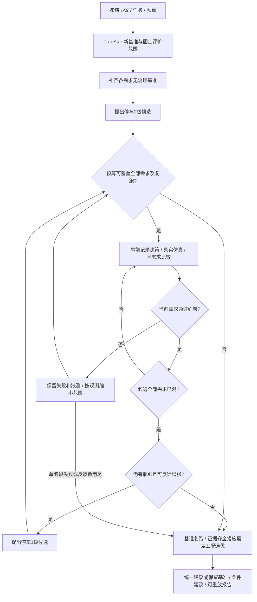

# 主动稳健 Agent：面向评分证据的增强

本轮把原先的跨需求事后筛选接入实际实验控制：agent 依据已经完成的 TranStar 输出决定下一次工具参数。它仍是确定性规则智能体，不依赖大语言模型。赛题允许规则推理与脚本工具调用，关键是能运行、能反馈、能复现。

已完成的主实验及取舍见 [真实结果](主动稳健搜索主实验结果.md)，第二个区域的拒绝与回退见 [迁移结果](主动稳健搜索迁移结果.md)。两组共 16 个真实场景、112 次模块调用，86 项自动化测试通过。

## 对应的评分要求

依据 [赛题原文摘录](../工作材料/文本摘录/赛题.txt)。分值是赛题权重，不是本项目已获分数。

| 评分项 | 权重 | 本轮实现与验收证据 |
| --- | ---: | --- |
| 智能体实际参与程度 | 15 | 失败工况的真实路段观测改变下一次治理范围；`search_trace` 给出读取哪次结果、为何修改、何时执行 |
| 完整闭环 | 6 | 新基准→诊断→提出措施→真实运行→约束评估→反馈→全需求验证→形成报告 |
| 基于反馈比较或调整 | 3 | 任一工况失败即拒绝统一候选，缩小后重测；全部通过且仍有瓶颈才增强等级 |
| 复现与敏感性 | 3 | 同需求无治理配对；所有需求保持同一评价范围；同输入复跑四类数组 |
| 同输入复现与运行质量 | 4 + 其他运行分项 | 事前冻结协议、预算保护、工具参数白名单、决策重放、原生输出重新计算核验 |
| 展示准确性 | 5 | 大地图配对原生输出；失败和缺测均可见；统一建议与条件建议分别说明 |

已有的等预算反馈对照、单向/禁转组合、运行手册、迁移实验与真实视频继续作为其他评分证据。本轮不把“多做了计算”直接当作算法优越性，也不将测试数量换算成得分。

## 新流程



图中的反馈边还受预定候选数与去重规则约束；基准复跑按任务设置执行。

1. 在首次模型调用前保存 `search_protocol.json`，固定任务、阈值、需求、预算、停止和选择规则。
2. 运行 1.0 需求新基准，诊断指定区域或自动选点，冻结核心/邻区/全网。其余需求分别建立无治理基准。
3. 初始候选为选中路段的停车 2 级。先测试最高需求，其后按需求系数降序。
4. 任一需求违反核心收益、邻区耗时、全网耗时或邻区新增过饱和约束，则该措施不能作为统一推荐，停止其剩余需求试验。尚未运行的配对明确记为缺测。
5. 对失败工况，计算每条治理路段的联合仿真耗时减少量 `L × (q前/v前 − q后/v后)`，保留排序前半，至少一条；同值按节点编号。下一候选先复核刚失败的需求，再补齐其他需求。
6. 全部需求通过后，若任何已测工况核心速度低于任务目标，或管理修正负荷仍超过 1，才试验停车 1 级并重新验证全部需求。
7. 每次启动候选前，预留完整需求配对与基准复跑预算。达到反馈上限、重复措施、单路段失败、预算不足或强度停止条件时结束搜索。
8. 同一措施必须在所有设定需求中通过原约束，才进入最差工况选优。否则统一建议保留基准；各需求可以有单独的合格条件建议。

路段排序只是**联合治理中的观测**：流量会重新分配，因此不能把某条路的改善视作它的独立因果贡献。缩小后的收益和外溢必须由下一次真实仿真确认。

## 如何使用

网页左侧选“停车治理”，勾选“主动稳健搜索”。默认三个需求系数 0.9 / 1.0 / 1.1、预算 11 次、最多两次反馈。预览完整任务卡后开始仿真。右侧“算法决策”展示各措施的需求通过/失败/缺测情况，以及每次事前决策。

命令行复现本轮主实验：

```powershell
cd F:\ITS比赛
.venv\Scripts\python.exe -m traffic_agent run --task examples/parking_robust.json
# 受限中文模板也支持“主动稳健”或“稳健搜索”关键词：
.venv\Scripts\python.exe -m traffic_agent plan --request "主动稳健停车治理；预算：11"
```

自动选点可以从任务卡移除 `links`；指定其他道路时设置 `road_name`，并移除不属于该道路的固定 `links`。控制器不为找到好结果而自动跳到别的区域。

旧任务默认 `search_mode: "standard"`，旧实验不会改写成新算法结果。新模式目前仅支持停车治理，至少两个需求系数。单向和禁转仍用已验证的完整组合流程。新模式结束后不接受旧版 `adapt` 追加，以保护完整的事前协议；修改参数应新建任务。

## 如何验收

```powershell
.venv\Scripts\python.exe -m unittest discover -s tests -q
.venv\Scripts\python.exe scripts/verify_experiment.py 智能体实验/jobs/实际任务编号 --seal
# 在复制/下载得到的封存档案上核验：
.venv\Scripts\python.exe scripts/verify_experiment.py 智能体实验/jobs/实际任务编号 --archive
```

核验先检查原始进程日志、输入白名单、OD 响应、新生成输出、指标和约束，再对新搜索检查：

- 协议确实在第一次计算前保存；诊断和冻结范围可由新基准重算。
- 用于反馈的核心路段观测逐项符合原生输出。
- 下一次工具参数可由此前观测和冻结规则重放，实际调用与决策相同。
- 决策及事件时间位于上一次计算结束和本次开始之间。
- 预算、早停、反馈次数、预留复跑和最终选择规则一致。
- 统一措施的全部需求复核不能被不同需求的条件推荐替换。

`verification.json/active_search_audit` 是该项结果；`report.md` 自动生成决策表、需求证据矩阵与停止原因。核验是软件与记录一致性检查，不是外部可信时间戳认证，也不能证明现实模型标定有效。

## 证据边界

本算法是预算内的确定性启发式搜索，不保证全局最优；高需求优先是预设顺序，不伪装成从数据学出的规律。提前拒绝省去了不再需要的配对，但缺测不等于实测节省的对照成本。若要量化相对另一种搜索的计算效率，需要额外事前冻结、同预算同条件对照。

研究对象仍是经过赛事调整的南京案例；小汽车需求变化不代表所有车型同比变化。`Σ(qL/v)` 是路段行驶时间消耗，不包含全部独立节点延误。核心收益可能包含车流转移；停车承接、执法成本及实际实施条件尚未验证。
