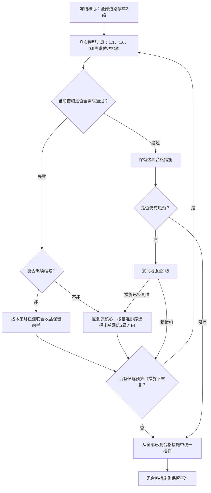

# 稀疏策略与回退搜索挑战

本轮检查一个具体问题：反馈策略缩减到单条道路后失败，是否因过早停止而错过冻结核心内的其他方向。新增算法独立保存在 `traffic_agent/challenge.py`，旧研究和旧算法保持原版本。测试中的人工观察仅验证控制逻辑；实际绩效必须来自新的 TranStar 执行。

## 事前协议

每个区域的三种策略均有 13 个逻辑场景上限：三个独立需求基准、最多三种措施各三个需求点、一次基准复跑。任一需求触犯硬约束就拒绝该措施，其余需求保留缺测。相同输入可共享一次物理执行，但每种策略仍分别计费。三策略的下一步决定全部落盘之后，才读取任何新结果。

| 策略 | 下一步措施如何产生 |
| --- | --- |
| `fixed_diverse` | 预先固定“全部核心2级、基准qL/v最高单路段2级、次高单路段2级”；去重后不足三项，补全部核心1级。固定序列允许单路段治理，避免只与过弱的全路段策略比较。 |
| `feedback_halving` | 失败时按本策略实测联合治理qL/v收益保留前半；全部需求通过但仍有瓶颈则增强至1级；无法缩减或重复时停止。与原研究逻辑一致，但本轮上限统一为三候选。 |
| `feedback_backtracking` | 同原反馈；无法继续当前方向时，回到原冻结核心，按基准qL/v排序尝试未单独测过的2级方向。已通过的措施保留，试探失败不会抹掉旧赢家。 |

基准优先级只依据1.0需求的qL/v，平局按节点编号；反馈缩减依据已观察的联合治理收益，不将其解释为单路段因果效应。推荐继续使用 tolerance-v2；核心、邻区、全网指标及硬约束沿用既有定义。



原缩减反馈在“不能继续缩减”或“措施已经测过”处停止；回退版本才会尝试其他方向。箭头代表控制逻辑，实际是否触发及结果必须以本轮轨迹为准。

## 新区域与版本约束

`config/challenge_history.json` 固定记录执行前已有的16份范围文件和上一轮三个前瞻区域，共19个排除记录。重复范围取并集，登记文件只含核心、邻区与来源摘要，不引入历史治理成绩。它随源码提交，新执行不依赖未跟踪的本地历史目录。

使用新执行的1.0基准，从完整候选集按密度分层、节点顺序选区。核心加两跳邻区必须与上述历史范围及本轮其他区域不相交；无候选的层保留空缺。任何治理场景开始前冻结区域及评价范围，不能按治理效果更换道路。

本轮最多67个物理场景，是三策略最多各三候选、首候选共享的保守上限。实际物理数通常更少。执行前保存协议、输入摘要、代码与登记文件快照、原生程序摘要；结束时重新核对。原生运行期间不要修改 `traffic_agent/*.py`、本轮启动脚本或登记文件。

## 执行与核验

在仓库根目录使用 Python 3.12 环境：

```powershell
.venv/Scripts/python.exe scripts/benchmark_challenge.py
```

它取得现有原生运行锁，新建 `智能体实验/challenges/<任务编号>`，执行真实 TranStar 七个模块。历史目录不会被覆盖。研究运行器的67物理场景上限与每策略13场景任务卡分别计数。

执行完成后，对新目录严格重算并封存：

```powershell
.venv/Scripts/python.exe scripts/verify_region_study.py 智能体实验/challenges/<任务编号> --seal
```

核验器按任务类型选择显式版本适配，逐个重读原生数组、输入修改、进程与输出时间、需求缩放、冻结选区，并重放三策略决定和共享计费。传输后的档案使用 `--archive --readonly`。旧三地区档案仍使用原协议与原算法核验。

只读地图入口：

```powershell
.venv/Scripts/python.exe scripts/serve_challenge.py 智能体实验/challenges/<任务编号> --port 8783
```

打开 `http://127.0.0.1:8783/`，左侧切换三个区域、三种策略和已完成场景。中央地图按相同需求配对，白色边线标本次实际措施，紫色标固定评价核心；右侧保留失败原因、近邻代价、参数响应及回退轨迹。下方“展开全部区域”显示完整九组对照。只读服务不启动模型，启动终端按 Ctrl+C 即可停止。

封存后导出新的评审摘要和图表：

```powershell
.venv/Scripts/python.exe scripts/report_challenge.py 智能体实验/challenges/<任务编号> 成果/回退挑战/<任务编号>
```

导出会重新核验完整原始档案，输出目录必须不存在。它不会修改已有正式阅读版或把运行中的部分结果标成最终结论。

也可以对已经启动的某一个任务连接自动收尾流程：

```powershell
.venv/Scripts/python.exe scripts/finalize_challenge.py 智能体实验/challenges/<任务编号> 成果/回退挑战/<任务编号> --wait-seconds 21600
```

该命令最多等待6小时，不启动第二次仿真。原任务完成且最终报告就绪后才严格核验、封存、再次核验并导出；失败、超时或输出目录已存在时停止，保留原进程和证据供检查。图表导出后仍需检查实际排版与结论。

## 结论边界

本轮比较三个策略在相同预算下的合格措施、统一推荐、最坏需求下的收益、邻区风险和调用数。允许固定策略打平或获胜。只有回退触发且产生有用证据，才能说明对应机制在这些案例上有帮助。三个区域不代表跨城市有效或全局最优；确定性复跑不构成统计独立重复。新旧实验预算不同，不直接比较两轮胜率来宣称算法增益。
